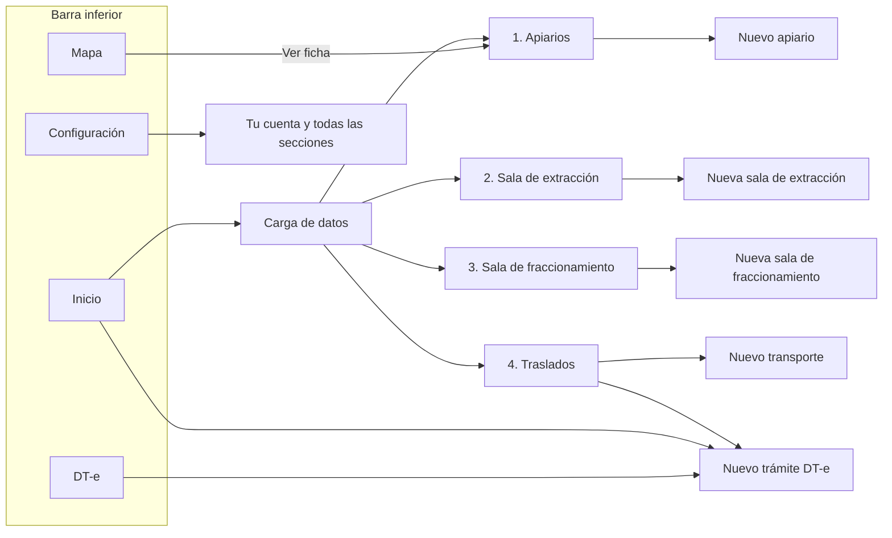
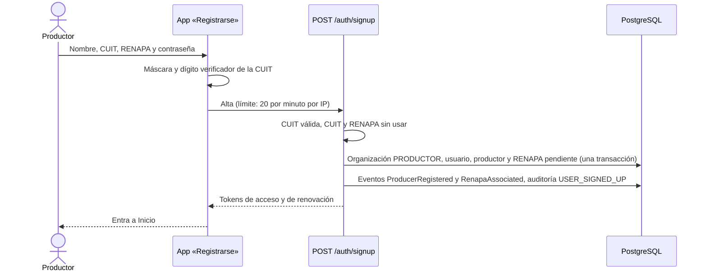
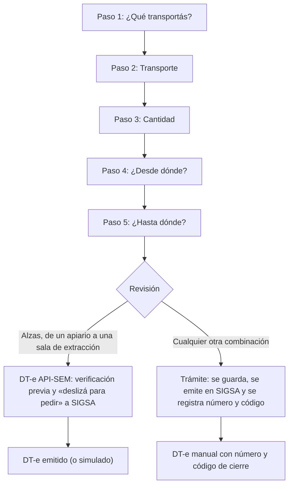
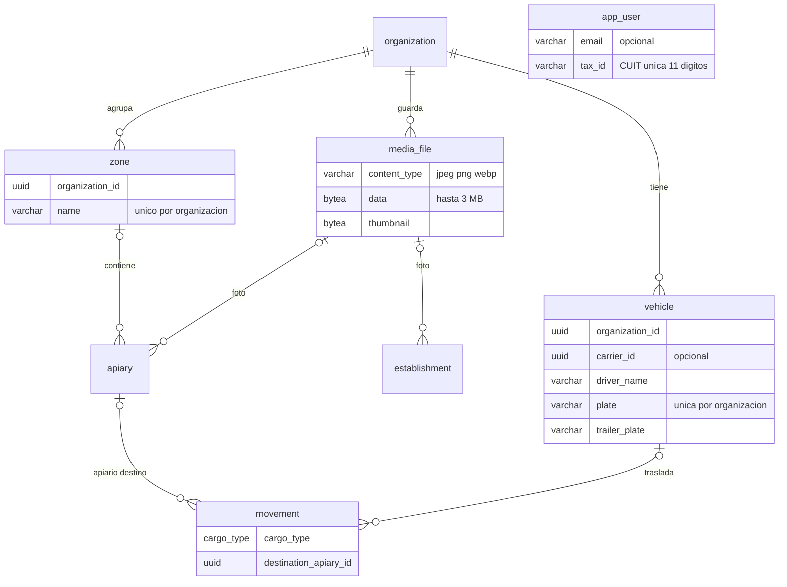

# 13 — Rediseño de interfaces: cuenta, maestros de datos y trámite DT-e

| | |
|---|---|
| **Proyecto** | ApiTrace (BeeTrace) — emisión de DT-e y trazabilidad de la miel |
| **Fecha** | 21/10/2026 |
| **Rama** | `feat/interfaces-oscuras-maestros-dte` (sin commit; el cambio viaja como parche) |
| **Base** | commit `89ed940` — «feat: habilitar y desplegar usuarios de prueba por defecto en Render» |
| **Parche** | `13-rediseno-interfaces.patch` — 105 archivos (46 nuevos, 57 modificados, 2 eliminados) |
| **Capturas** | `C:\github\BeeTrace\Claude outputs\13-rediseno-interfaces\capturas\` — comparación con tus capturas, teléfono, tableta, escritorio y tema claro |
| **Estado** | Implementado y verificado: 52 pruebas unitarias y 89 de punta a punta en el backend, 32 en el frontend, compilación limpia |

Este documento acompaña el rediseño pedido a partir de las siete capturas de referencia: creación de cuenta, carga de datos (apiarios, sala de extracción, sala de fraccionamiento, traslados) y el asistente «Nuevo Trámite DT-e». Explica qué se construyó, cómo cambió la base de datos, qué riesgos quedan abiertos y cómo aplicar el parche.

---

## 1. Qué cambió, pantalla por pantalla

| # | Pantalla | Ruta | Referencia | Comparación |
|---|---|---|---|---|
| 1 | Registrarse — «Creá tu cuenta» | `/registro` | Captura 1 | `capturas/comparacion/01-creacion-de-cuenta.png` |
| 2 | Carga de datos — «Seleccioná qué cargar» | `/carga` | Captura 2 | `capturas/comparacion/02-carga-de-datos.png` |
| 3 | Nuevo apiario | `/apiaries/nuevo` | Captura 3 | `capturas/comparacion/03-nuevo-apiario.png` |
| 4 | Nueva sala de extracción | `/salas/extraccion/nueva` | Captura 4 | `capturas/comparacion/04-nueva-sala-extraccion.png` |
| 5 | Nueva sala de fraccionamiento | `/salas/fraccionamiento/nueva` | Captura 5 | `capturas/comparacion/05-nueva-sala-fraccionamiento.png` |
| 6 | Nuevo transporte | `/traslados/transporte/nuevo` | Captura 6 | `capturas/comparacion/06-nuevo-transporte.png` |
| 7 | Nuevo trámite DT-e, pasos 1 a 5 | `/dte/nuevo` | Captura 7 | `capturas/comparacion/07…11-tramite-paso-N.png` |

Además, para que las pantallas nuevas tengan de dónde colgarse:

| Pantalla | Ruta | Qué hace |
|---|---|---|
| Iniciar sesión | `/login` | Mismo lenguaje que el registro. Se entra con **CUIT o correo** y contraseña. |
| Inicio | `/` | Suma dos accesos grandes: **Carga de datos** y **Mapa**. |
| Apiarios | `/apiaries` | Lista agrupada **por zona**, con cifras (apiarios, colmenas, zonas), buscador, filtro por zona y foto. |
| Salas de extracción / fraccionamiento | `/salas/:tipo` | Salas propias con RNE, habilitación SENASA, ubicación y foto; atajos a tambores, extracciones y lotes. |
| Traslados | `/traslados` | Vehículos guardados (alta, baja y reactivación) y atajos a «Nuevo trámite DT-e», DT-e y movimientos. |
| Mapa | `/mapa` | Apiarios, fincas, depósitos y salas sobre OpenStreetMap, con filtros, «Mi ubicación» y distancias. |
| Configuración | `/settings` | Suma «Tu cuenta» (con **Cerrar sesión**) y «Todas las secciones», porque la barra inferior ahora tiene cuatro destinos. |

### Barra inferior

Como en la captura de «Carga de datos»: **Inicio · Mapa · DT-e · Configuración**. Inicio va relleno cuando está activo y queda marcado también dentro de Carga de datos y sus maestros. Las pantallas de alta y el asistente se abren a pantalla completa, sin barra, para que el teclado y el botón principal tengan todo el alto.

### Tableta y escritorio (a criterio, como se pidió)

- **Escritorio (≥ 900 px):** vuelve la barra lateral (fondo `--nav-bg`) con todas las secciones. Los formularios se centran en una columna de 600 px y el asistente en 760 px, con «Atrás» y «Siguiente» alineados a la derecha.
- **Tableta (≥ 600–700 px):** la grilla de «¿Qué transportás?» pasa a 3 columnas, los 5 tipos de origen/destino entran en una fila y Carga de datos se ve en 2 columnas.
- **Teléfonos angostos (< 360 px):** el botón de ubicación y el contador bajan a una segunda línea dentro de su tarjeta.

---

## 2. Lenguaje visual

El oscuro es el modo principal. El claro sigue a un toque en Configuración para quien trabaja a pleno sol.

| Token | Oscuro | Uso |
|---|---|---|
| `--bg` | `#1a1b20` | Fondo carbón apenas azulado |
| `--surface` · `--field` | `#25262d` | Tarjetas y tarjetas-campo |
| `--surface-2` | `#2c2d35` | Hover y recuadros |
| `--surface-3` | `#34353e` | Pasos pendientes, deshabilitado |
| `--primary` | `#f0ae3a` | Ámbar de la miel: acción y elección (8,9:1 sobre el fondo) |
| `--primary-fg` | `#1c1406` | Texto sobre ámbar (9,4:1) |
| `--primary-soft` | `#3a2a14` | Fondo tostado de lo elegido |
| `--band` | `#2e2417` | Franja de pasos del asistente |
| `--done` | `#34a853` | Paso cumplido |
| `--sky` | `#36c9fc` | Acento de Traslados («Nuevo Transporte») |
| `--nav-bg` | `#131217` | Barra inferior y lateral |
| `--text-1/2/3` | `#f4f4f6` / `#c9c9d1` / `#a3a4ad` | Texto principal, secundario y de ayuda (≥ 6:1) |

Reglas que se mantienen del sistema: ningún texto por debajo de 4,5:1, ningún borde o ícono informativo por debajo de 3:1, el color nunca es la única señal (lo elegido lleva borde, fondo **y** tilde) y todo control mide al menos 44 px de alto o extiende su área táctil.

Piezas propias del rediseño (en `frontend/src/redesign.css`, cargado después de `styles.css`):

- **Tarjeta-campo**: ícono a la izquierda, rótulo numerado en versalitas («1. NOMBRE») y el campo debajo. El foco se marca en la tarjeta entera.
- **Encabezado de formulario**: ícono ilustrado grande (persona con «+», base de datos con «+», colmena, frasco, camión), título y bajada.
- **Ilustraciones de carga** dibujadas en SVG (alza, colmena, núcleo, tambor, frasco, reina) y de vehículos (camioneta, camión, acoplado, furgón, utilitario, otro). No dependen de fotos externas ni de derechos de terceros.

---

## 3. Flujos

### 3.1 Navegación



### 3.2 Creación de cuenta

Decisiones tomadas con vos: se entra con **CUIT + contraseña**, y la cuenta nueva queda **activa como Productor** con el RENAPA **pendiente de verificación**.



### 3.3 Trámite DT-e en cinco pasos

Las capturas suman cinco cargas que el DT-e de API-SEM no cubre (colmenas, núcleos, tambores, frascos y reinas) y cinco tipos de lugar. Para no prometer lo que SIGSA no ofrece por API, el asistente distingue dos caminos al llegar a la revisión:



| Carga | Movimiento | Material | Unidad |
|---|---|---|---|
| Alzas | Material melario | Material melario | Alza |
| Colmenas | Material vivo | Colmena | Colmena |
| Núcleos | Material vivo | Núcleo | Unidad |
| Tambor | Miel a granel | Miel | Tambor |
| Frascos | Producto fraccionado | Miel | Unidad |
| Reinas | Material vivo | Reina | Unidad |

Lo que se conservó del asistente anterior: borrador que se retoma desde Inicio, «la última vez» primero, elección automática cuando hay una sola opción, verificación previa con los mismos controles, días de vigencia y «deslizá para pedir». La reemisión desde un DT-e anulado salta directo a transporte, cantidad y revisión.

---

## 4. Base de datos — migración `0003_maestros_y_tramite`

Aditiva e idempotente: crea solo lo que falta, se puede volver a correr y no inventa datos.

| Tabla | Cambio | Para qué |
|---|---|---|
| `app_user` | `email` pasa a opcional; nueva `tax_id` (CUIT, 11 dígitos, única); controles `app_user_identifier_ck` (correo o CUIT) y `app_user_tax_id_ck` | Entrar con CUIT |
| `zone` (nueva) | `organization_id`, `name`; único por organización sin distinguir mayúsculas | Apiarios por zona |
| `media_file` (nueva) | Foto (`bytea`, hasta 3 MB) y miniatura; solo JPEG, PNG o WebP | Fotos de apiarios y salas |
| `apiary` | `zone_id`, `photo_id` (con índices) | Zona y foto del apiario |
| `establishment` | `photo_id` | Foto de la sala |
| `vehicle` | Pasa a pertenecer a una organización (`organization_id`); transportista opcional; `name`, `driver_name`, `created_by_id`; patente única **por organización** (ya no en toda la plataforma) | Vehículos guardados con conductor |
| `movement` | `cargo_type` y `destination_apiary_id` | Qué se transporta y apiario de destino |
| Enums | `cargo_type` (nuevo); `establishment_type` + `FINCA_POLINIZACION`; `material_type` + `REINA` | Las cargas y lugares de las capturas |

Datos existentes: el vehículo de una transportista con organización pasa a esa organización, y los movimientos ya hechos reciben su `cargo_type` solo cuando la equivalencia es inequívoca.



> **Atención:** Drizzle aplica todas las migraciones pendientes en una sola transacción. Por eso los valores de enum nuevos (`FINCA_POLINIZACION`, `REINA`) no se usan dentro de esta misma migración: PostgreSQL no lo permite hasta confirmarla. Se probó en base vacía, sobre una base con la 0002 y corriéndola dos veces.

---

## 5. API nueva o modificada

| Método | Ruta | Roles | Para qué |
|---|---|---|---|
| POST | `/auth/signup` | Público (20/min por IP) | Crear cuenta de productor |
| POST | `/auth/login` | Público | Ahora acepta CUIT además de correo |
| GET | `/media/:id` · `/media/:id/thumbnail` | Con sesión: fotos de tu organización o de una sala activa de cualquier organización | Foto o miniatura como `data:` URL |
| GET · POST · PATCH · DELETE | `/zones` | Leer: con sesión · Escribir: ADMIN, PRODUCTOR | Zonas con cantidad de apiarios y colmenas |
| GET · POST · PATCH | `/vehicles` | Escribir: ADMIN, PRODUCTOR, SALA, ACOPIADOR, FRACCIONADOR, TRANSPORTISTA | Vehículos guardados (`?all=true` incluye los de baja) |
| GET | `/places?side=origin\|destination&type=…&q=…` | Con sesión | Orígenes propios; destinos propios y salas públicas activas |
| GET | `/places/map` | Con sesión | Lugares con ubicación, los que no la tienen y conteos |
| POST · PATCH | `/apiaries` | Igual que antes | Acepta `zoneId` o `zoneName` (crea la zona) y `photo`; establecimiento y código pasan a ser opcionales (se completan solos) |
| POST · PATCH | `/establishments` | Igual que antes | Acepta `photo` y el tipo `FINCA_POLINIZACION` |
| POST | `/dte/preflight` · `/dte` | ADMIN, PRODUCTOR, SALA, ACOPIADOR, FRACCIONADOR | Aceptan `cargoType`, `originEstablishmentId`, `destinationApiaryId` y `vehicleId`; la verificación devuelve `kind: API_SEM \| TRAMITE` |

Códigos de error nuevos, con su mensaje en la app: `CUIT_INVALIDA`, `CUIT_REGISTRADA`, `RENAPA_REGISTRADO`, `FOTO_INVALIDA`, `FOTO_DEMASIADO_GRANDE`, `TRAMITE_SOLO_MANUAL`, `ORIGEN_IGUAL_DESTINO`, `ORIGEN_DESTINO_REQUERIDOS`.

**Fotos:** el teléfono las achica antes de enviarlas (1280 px, JPEG al 78 % y miniatura de 320 px, unos 150–300 KB) y viajan dentro del mismo pedido de alta, así que también funcionan sin señal desde la cola de envíos. El backend acepta cuerpos JSON de hasta 5 MB.

---

## 6. Archivos

**Backend (nuevos):** módulos `media`, `zone`, `transport` (vehículos), `places`; `common/utils/cuit.ts`; `modules/movement/cargo.ts`; `body-limits.ts`; esquema `media.ts` y `zone.ts`; migración 0003 y su snapshot; prueba `test/maestros.e2e-spec.ts` (21 casos).

**Frontend (nuevos):** `redesign.css`; componentes `Screen` (barra superior y pantallas de foco), `MasterForm` (tarjetas-campo, ubicación, contador, foto, zona), `Illustrations`, `DteTramite` (asistente), `TransportForm`, `VehicleCard`, `MediaThumb`; páginas `RegisterPage`, `DataHubPage`, `ApiaryFormPage`, `SalasPage`, `SalaFormPage`, `TransportsPage`, `TransportFormPage`, `DteNewPage`, `MapPage`; utilidades `cargo`, `cuit`, `geo`, `photo`, `salas`.

**Eliminados:** `DteWizard.tsx` y `Pickers.tsx` (los reemplaza `DteTramite.tsx`).

---

## 7. Verificación

| Qué | Resultado |
|---|---|
| Backend: pruebas unitarias | 52/52 |
| Backend: pruebas de punta a punta (PostgreSQL 16 real) | 89/89, incluidas las 21 nuevas de maestros |
| Frontend: TypeScript, pruebas, compilación | Sin errores · 32/32 · el mapa va en un fragmento aparte (158 KB, 47 KB comprimido) que solo se descarga al abrirlo |
| Parche | `git apply --check` limpio sobre `89ed940` |
| Capturas | Teléfono 390×844, tableta 820×1180, escritorio 1440×900 y tema claro, en `capturas/` |
| Revisión con las Web Interface Guidelines | Corregido: nombres de campo para los gestores de contraseñas, alto y ancho de las fotos, foco visible por debajo de las barras fijas, espacio fijo entre número y unidad, marca sin traducir, filtros que bajan de línea con mouse |

---

## 8. Dependencias técnicas

| Dependencia | Dónde | Acción |
|---|---|---|
| `leaflet` 1.9.4 y `@types/leaflet` | Frontend | `npm install` en `frontend` |
| Migración 0003 | Backend | `npm run db:migrate` (en Render ya la corre `start:render`) |
| `VITE_MAP_TILE_URL` y `VITE_MAP_ATTRIBUTION` | Frontend, opcional | Proveedor de mapa para producción (ver riesgo 1) |
| HTTPS | Despliegue | «Obtener ubicación» y la cámara solo funcionan en contexto seguro |
| Seed actualizado | Backend, opcional | Datos de prueba: zonas, salas de otras organizaciones, finca, depósito y vehículos |

---

## 9. Riesgos y mitigaciones

| # | Riesgo | Mitigación aplicada | Qué falta |
|---|---|---|---|
| 1 | La política de uso de `tile.openstreetmap.org` no admite tráfico intensivo de producción | URL de teselas configurable y atribución visible | Contratar un proveedor (MapTiler, Stadia, Thunderforest) o servidor propio antes del piloto |
| 2 | Fotos en la base (`bytea`) hacen crecer Neon y sus copias | Compresión en el teléfono, tope de 3 MB, miniaturas | Pasar a almacenamiento de objetos (R2/S3) con URLs firmadas si el volumen crece |
| 3 | Alta pública: bots o altas masivas | Límite de 20 por minuto por IP, dígito verificador, CUIT y RENAPA únicos | Captcha o verificación por correo/SMS |
| 4 | Alguien registra una CUIT ajena | El RENAPA queda «pendiente de verificación» y se advierte en el DT-e; SIGSA solo emite si el titular delegó el servicio en ARCA con su clave fiscal | Validar contra el padrón de ARCA y un circuito de reclamo de CUIT |
| 5 | Migración en Neon dentro de una transacción | Idempotente, aditiva, probada en tres escenarios | Correrla primero en una rama de Neon |
| 6 | Cuerpos JSON de 5 MB | Límite por ruta, fotos ya comprimidas | Vigilar memoria del servicio en Render |
| 7 | Trámites que no van por API (colmenas, núcleos, tambores, frascos, reinas) | Quedan como borrador hasta registrar número y código emitidos en SIGSA | Cuando SENASA publique más servicios, sumarlos al camino automático |
| 8 | Quien había elegido el tema claro pasa una vez al oscuro | Marca `apitrace.theme.v2`; se vuelve a claro en Configuración | — |
| 9 | Navegadores sin `:has()` (anteriores a Chrome 105, Safari 15.4, Firefox 121) | Solo se pierden detalles (ancho del asistente, color del placeholder del desplegable) | — |
| 10 | Mapa oscuro por filtro CSS sobre teselas claras | Legible en las pruebas | Estilo oscuro nativo del proveedor de mapas |
| 11 | El acento celeste de Traslados (tomado de la captura) suma un segundo color | Se limita al alta de transporte | Si se prefiere un solo acento, quitar `theme-sky` |

---

## 10. Habilidades instaladas para cada etapa

Buscadas con *find-skills* y elegidas por fuente oficial o por cantidad de instalaciones.

| Habilidad | Fuente | Etapa | Instalación |
|---|---|---|---|
| frontend-design | ya estaba | Dirección visual de las pantallas | — |
| web-design-guidelines | vercel-labs/agent-skills | Revisión final de accesibilidad y UX | `npx skills add vercel-labs/agent-skills --skill web-design-guidelines` |
| vercel-react-best-practices | vercel-labs/agent-skills | Componentes React, carga diferida del mapa | `npx skills add vercel-labs/agent-skills --skill vercel-react-best-practices` |
| nestjs-best-practices | kadajett/agent-nestjs-skills | Módulos, validación y límites de pedidos | `npx skills add kadajett/agent-nestjs-skills --skill nestjs-best-practices` |
| drizzle-orm-patterns | giuseppe-trisciuoglio/developer-kit | Esquema y migración Drizzle | `npx skills add giuseppe-trisciuoglio/developer-kit --skill drizzle-orm-patterns` |
| supabase-postgres-best-practices | supabase/agent-skills | Índices, restricciones y migración en PostgreSQL | `npx skills add supabase/agent-skills --skill supabase-postgres-best-practices` |
| neon-postgres | neondatabase/agent-skills | Llevar la migración a Neon | `npx skills add neondatabase/agent-skills --skill neon-postgres` |
| webapp-testing | anthropics/skills | Capturas y recorridos con Playwright | `npx skills add anthropics/skills --skill webapp-testing` |

---

## 11. Cómo aplicar el cambio

En PowerShell, sobre tu copia del repositorio:

```powershell
cd C:\github\ApiTrace
git status                     # que no haya cambios sin guardar
git log -1 --format=%h         # la base esperada es 89ed940
git switch -c feat/interfaces-oscuras-maestros-dte
git apply --index "C:\github\BeeTrace\Claude outputs\13-rediseno-interfaces\13-rediseno-interfaces.patch"
# Si tu rama avanzó desde 89ed940: git apply --3way "…\13-rediseno-interfaces.patch"

cd frontend
npm install                    # agrega leaflet
cd ..\backend
npm run db:migrate             # migración 0003
npm run db:seed                # opcional, solo en una base de desarrollo
```

Para probarlo: `npm run start:dev` en `backend` y `npm run dev` en `frontend`. Usuario de prueba: `productor@apitrace` / `ApiTrace2026!`, o creá una cuenta nueva desde «Registrarse».

---

## 12. Próxima iteración

1. Proveedor de mapas para producción y estilo oscuro nativo.
2. Verificación del RENAPA por un administrador desde la app y aviso al productor.
3. Aviso de cambios sin guardar en los formularios de alta.
4. Retirar «Vehículo habitual» de Configuración: los vehículos guardados lo reemplazan.
5. Fotos en almacenamiento de objetos si el volumen lo justifica.
