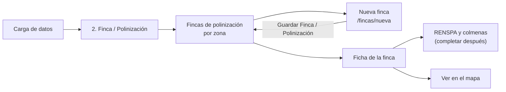
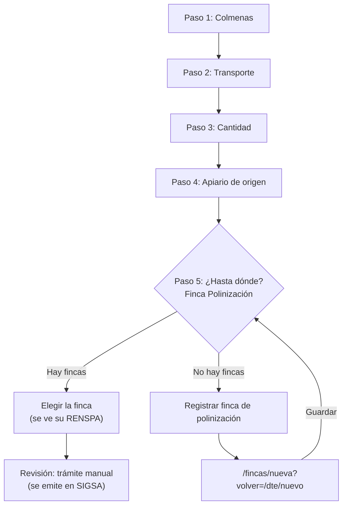
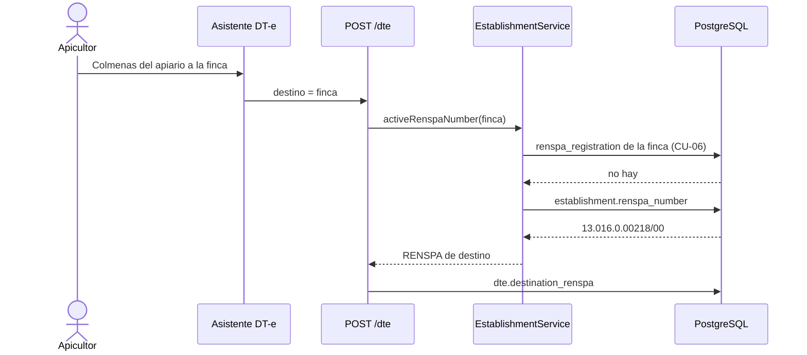
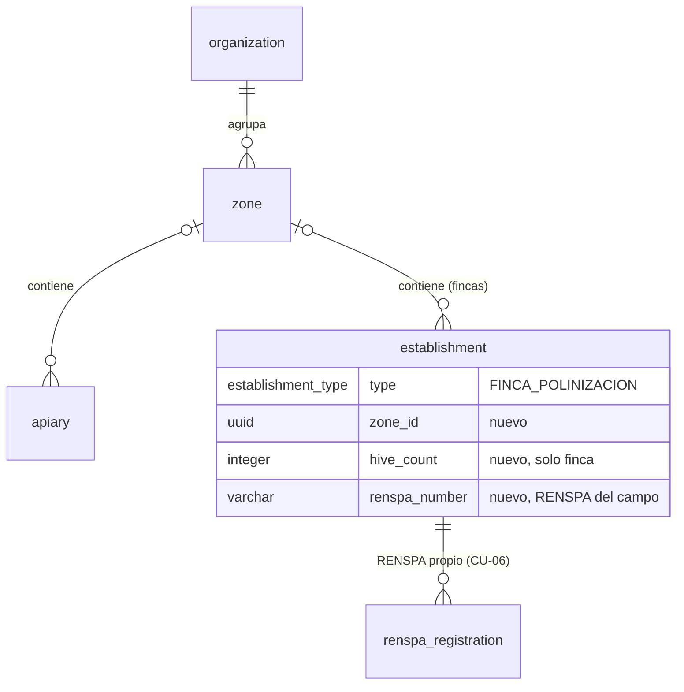

# 14 — Finca / Polinización en Carga de datos

| | |
|---|---|
| **Proyecto** | ApiTrace (BeeTrace) — emisión de DT-e y trazabilidad de la miel |
| **Fecha** | 29/10/2026 |
| **Pedido** | Rodrigo Bravo, por WhatsApp: «Eso debe ser cambiado por…», con la captura del menú nuevo y la del alta de la finca |
| **Rama** | `feat/fincas-polinizacion` (sin commit; el cambio viaja como parche) |
| **Base** | commit `edc2729` — «fix(ui): responsive help bottom sheet…», que ya incluye el rediseño del doc 13 (`b236057`) |
| **Parche** | `14-finca-polinizacion.patch` — 30 archivos (8 nuevos, 22 modificados) |
| **Capturas** | `C:\github\BeeTrace\Claude outputs\14-finca-polinizacion\capturas\` — comparación con las capturas de Rodrigo, teléfono, tema claro y escritorio |
| **Estado** | Implementado y verificado: 52 pruebas unitarias y 99 de punta a punta en el backend (10 nuevas), 40 en el frontend (8 nuevas), compilación limpia y recorrido real con Playwright |

Rodrigo pidió sumar «Finca / Polinización» a Carga de datos y mandó cómo tenía que verse el alta. Este documento explica qué se construyó, cómo quedó la base de datos, qué riesgos quedan y cómo aplicar el parche.

---

## 1. El pedido, las respuestas y las decisiones

| # | Lo que pidió Rodrigo | Lo que se aclaró con él | Cómo quedó |
|---|---|---|---|
| 1 | Sumar **«2. Finca / Polinización»** entre Apiario y Sala de extracción | — | Quinta opción del menú. Las demás se renumeran solas: el número sale del orden |
| 2 | «Apiarios» pasa a **«Apiario»** | Se tomó como intencional | Hecho |
| 3 | Alta de la finca: nombre, zona, RENSPA, geolocalización, número de colmenas y foto | — | `/fincas/nueva`, con los textos y el orden de su captura |
| 4 | Número de colmenas | **Las colmenas que se llevan a polinizar** | Se cargan con el contador al registrar la finca y se pueden corregir desde su ficha. No se suman a las colmenas de los apiarios |
| 5 | RENSPA | **Opcional** | Opcional al registrar. Se completa, corrige o quita después desde la ficha |
| 6 | «Registro de fincas y polinización» | **Alcanza con registrar el lugar** | No se registra el servicio (cultivo, fechas). El traslado de las colmenas ya queda en el DT-e |
| 7 | Traslados aparecía resaltado en celeste | **Fue cómo quedó la imagen: que siga el estándar** | Misma tarjeta que el resto de las opciones |

Decisiones tomadas sin preguntar, porque tienen una respuesta razonable por defecto:

- **«Sala de fraccionamiento» queda en minúscula**, igual que «Sala de extracción». En la captura venía con F mayúscula.
- **El título del alta dice «Registrá un nuevo lugar de Finca / Polinización»**. La captura decía «Polinización / Finca», pero el menú, la barra superior y el botón dicen «Finca / Polinización».
- **Al tocar la opción se abre la lista de fincas**, como pasa con Apiarios, y el alta queda a un toque.
- **Las fincas usan las mismas zonas que los apiarios.**
- **Ven la opción el productor, el administrador y el auditor**, los mismos que ven Apiarios. El auditor solo consulta.

---

## 2. Qué cambió, pantalla por pantalla

| # | Pantalla | Ruta | Qué cambió | Captura |
|---|---|---|---|---|
| 1 | Carga de datos | `/carga` | Cinco opciones. Ícono nuevo para la finca: la flor en el campo arado, como en la captura. En el teléfono el encabezado y las tarjetas se compactan para que las cinco entren en 390 × 844, sin achicar el texto | `comparacion/01-carga-de-datos.png` |
| 2 | Fincas de polinización | `/fincas` | Nueva. Fincas agrupadas por zona, con cifras (fincas, colmenas, zonas), buscador por nombre, RENSPA o zona, filtro por zona y foto | `movil/02-fincas-una.png`, `movil/06-fincas-guardada.png` |
| 3 | Finca / Polinización (alta) | `/fincas/nueva` | Nueva. Los seis campos de la captura. El RENSPA es opcional y se controla su forma. Ícono del granero con el árbol y la abeja | `comparacion/02-finca-polinizacion.png`, `movil/03` a `05` |
| 4 | Ficha de la finca | `/fincas` → tocar una | RENSPA, colmenas a polinizar, zona y ubicación, con «Cómo llegar» y «Ver en el mapa». «RENSPA y colmenas» permite completarlos después | `movil/07-finca-ficha.png`, `movil/08-finca-renspa-y-colmenas.png` |
| 5 | Nuevo trámite DT-e, paso 5 | `/dte/nuevo` | La finca muestra «RENSPA: …». Si no hay fincas, ofrece «Registrar finca de polinización» y al guardar vuelve al trámite con la finca elegida. Se corrigió el plural del aviso: antes decía «No hay finca de polinizacións registrados» | `movil/09` a `11` |
| 6 | Mapa | `/mapa` | La ficha de una finca lleva a `/fincas`; antes llevaba a Establecimientos | — |
| 7 | Inicio | `/` | El acceso dice «Apiarios, fincas, salas y traslados» | — |
| 8 | Barra lateral (escritorio) | — | «Fincas de polinización» en Maestros, con ícono de flor | `escritorio/02-fincas.png` |

Las piezas del formulario son las del doc 13 (tarjeta-campo, zona, ubicación, contador y foto). Para respetar la captura, la ubicación y la foto aceptan otro rótulo: la finca dice «Geolocalización», «Tomar foto» y «Tocar para tomar foto». El resto de los formularios no cambia.

---

## 3. Flujos

### 3.1 Registrar una finca



### 3.2 Llevar colmenas a la finca (DT-e)



### 3.3 De dónde sale el RENSPA de destino del DT-e



---

## 4. Base de datos — migración `0004_fincas_polinizacion`

Aditiva e idempotente, como la 0003: crea solo lo que falta y se puede volver a correr. Toca una sola tabla.

| Columna de `establishment` | Tipo | Para qué |
|---|---|---|
| `zone_id` | `uuid` → `zone(id)`, `ON DELETE SET NULL`, con índice | Zona de la finca, la misma de los apiarios. Borrar la zona deja la finca «sin zona» |
| `hive_count` | `integer`, control `IS NULL OR >= 0` | Colmenas que se llevan a polinizar. Solo la finca la usa; en salas y depósitos queda `NULL` |
| `renspa_number` | `varchar(60)`, opcional, **sin unicidad** | RENSPA del campo, tal como lo informa el apicultor |



**Por qué el RENSPA del campo va en la finca y no en `renspa_registration`:**

1. `renspa_registration` es el RENSPA **propio** del productor (CU-06): exige un productor de ApiTrace como titular. El campo es de un tercero, el dueño de la finca.
2. Su número es **único en toda la plataforma**. Varios apicultores llevan colmenas al mismo campo: el segundo que lo registrara recibiría un error.

El DT-e no pierde nada: toma primero el RENSPA asociado con CU-06 y, si no hay, el del campo (sección 3.3).

> **Atención:** Drizzle aplica todas las migraciones pendientes en una sola transacción. Por eso la 0004 no usa el valor `FINCA_POLINIZACION`, que en una base nueva llega en la misma transacción. Tampoco completa datos de las fincas ya cargadas: quedan sin zona, sin colmenas informadas y sin RENSPA hasta que alguien los cargue.

---

## 5. API

| Método | Ruta | Cambio |
|---|---|---|
| POST · PATCH | `/establishments` | Aceptan `zoneId` (con `null` se quita) o `zoneName` (crea la zona si no existe), `hiveCount` (0 a 100 000) y `renspaNumber` (vacío o `null` lo quita). Colmenas y RENSPA del campo solo se aceptan en `FINCA_POLINIZACION`; en otro tipo responden 400. El RENSPA son números con puntos, barra o guiones (ej. `01.002.0.00123/45`) y se recortan los espacios. Una finca nueva sin colmenas informadas queda en 0, como el apiario |
| GET | `/establishments` | Suma `zoneName` |
| GET | `/zones` | Suma `fincaCount` (fincas activas). `hiveCount` sigue contando solo los apiarios: las colmenas de la finca son esas mismas, llevadas a polinizar |
| DELETE | `/zones/:id` | Las fincas de la zona quedan sin zona, igual que los apiarios |
| GET | `/places` | La finca trae `code` = RENSPA del campo (`codeLabel: "RENSPA"`), `zoneId`, `zoneName` y `hiveCount`. La búsqueda incluye RENSPA y zona |
| POST | `/dte`, `/dte/preflight` y reemisión | RENSPA de destino: el asociado con CU-06 y, si no hay, el del campo de la finca |

---

## 6. Archivos

**Backend (nuevos):** `drizzle/0004_fincas_polinizacion.sql`, `drizzle/meta/0004_snapshot.json`.

**Backend (modificados):** `drizzle/meta/_journal.json`, `schema/establishment.ts`, `establishment.dto.ts`, `establishment.service.ts`, `zone.service.ts` (resolución de zona por organización, `fincaCount`, borrado), `zone.controller.ts` (descripción), `places.service.ts`, `seed.ts` (la finca de demostración trae zona, 48 colmenas y RENSPA), `test/maestros.e2e-spec.ts`.

**Frontend (nuevos):** `pages/FincasPage.tsx`, `pages/FincaFormPage.tsx`, `lib/hub.ts` (las opciones de Carga de datos), `lib/fincas.ts` (control del RENSPA), `lib/fincas.test.ts`.

**Frontend (modificados):** `DataHubPage.tsx`, `App.tsx`, `lib/nav.ts`, `Layout.tsx`, `MapPage.tsx`, `DashboardPage.tsx`, `DteTramite.tsx`, `MasterForm.tsx`, `Illustrations.tsx` (`fieldPlus` y `farmPlus`), `Icon.tsx` (`flower`), `lib/cargo.ts` (plural de cada lugar y `fincaCount`), `lib/types.ts`, `redesign.css`.

**Documentación:** este documento, en la raíz del repositorio.

---

## 7. Verificación

| Qué | Resultado |
|---|---|
| Backend: pruebas unitarias | 52/52 |
| Backend: pruebas de punta a punta (PostgreSQL 16 real) | 99/99, incluidas 10 nuevas de fincas |
| Frontend: TypeScript, pruebas, compilación | Sin errores · 40/40 (8 nuevas: orden del menú, roles, RENSPA, plurales) · compilación limpia |
| Migración 0004 | Base vacía (0000 a 0004 en una transacción), sobre una base con la 0003, dos corridas seguidas y el SQL aplicado dos veces a mano. `drizzle-kit generate` no encuentra diferencias con el esquema |
| Recorrido real con Playwright (390 × 844) | Alta con zona, RENSPA, ubicación, colmenas y foto; aviso de RENSPA mal escrito; lista, ficha y edición; DT-e de colmenas con la finca en el paso 5; cuenta nueva sin fincas que registra una desde el trámite y vuelve con el borrador intacto |
| Capturas | `movil/`, `claro/`, `escritorio/` y `comparacion/` |

Las 10 pruebas nuevas de punta a punta:

1. Registra la finca con zona, RENSPA del campo, ubicación, colmenas y foto.
2. El RENSPA es opcional y la zona se puede crear al vuelo por nombre.
3. Rechaza un RENSPA mal escrito, y colmenas o RENSPA en algo que no es una finca.
4. Otro apicultor puede registrar el mismo campo con el mismo RENSPA.
5. Lista las fincas con el nombre de su zona, solo las propias.
6. Cuenta las fincas por zona sin sumar sus colmenas a las de los apiarios.
7. Ofrece la finca como destino con su RENSPA, su zona y sus colmenas, y la encuentra por RENSPA.
8. El DT-e de colmenas a la finca lleva el RENSPA del campo como destino; sin RENSPA, queda vacío.
9. Completa el RENSPA y las colmenas después, y lo puede quitar.
10. Borrar la zona deja la finca sin zona, sin borrarla.

---

## 8. Dependencias técnicas

| Dependencia | Dónde | Acción |
|---|---|---|
| Migración 0004 | Backend | `npm run db:migrate` (en Render ya la corre `start:render`) |
| Seed actualizado | Backend, opcional | Solo en una base de desarrollo: la finca de demostración trae zona, colmenas y RENSPA |
| Paquetes nuevos | — | Ninguno |

---

## 9. Riesgos y pendientes

| # | Riesgo | Mitigación aplicada | Qué falta |
|---|---|---|---|
| 1 | El RENSPA del campo no se verifica contra SENASA | Se controla la forma y queda como dato informado por el apicultor | Validarlo contra el padrón cuando SENASA lo permita |
| 2 | Las colmenas de la finca se cargan a mano y pueden no coincidir con los DT-e de colmenas | Rodrigo las definió como «las que se llevan a polinizar»; se corrigen desde la ficha | Si hace falta el número real en cada momento, calcularlo con los DT-e de entrada y salida |
| 3 | Cada apicultor registra su propia copia del campo: no hay una finca compartida | El RENSPA del campo no es único, así que dos apicultores pueden cargar el mismo campo | Si se necesita ver todo lo que recibe un campo, unificar las fincas por RENSPA |
| 4 | Una finca con RENSPA asociado por CU-06 y además el del campo | Manda el de CU-06; el orden está documentado en `activeRenspaNumber` | — |
| 5 | Carga de datos queda más compacta en el teléfono | Solo debajo de 700 px y solo en esa pantalla; el texto conserva su tamaño | — |
| 6 | El título del alta y «Sala de fraccionamiento» difieren de la captura | Se priorizó la consistencia de nombres y se avisó antes de construir | Si Rodrigo prefiere su versión literal, son dos textos |

---

## 10. Cómo aplicar el cambio

En PowerShell, sobre tu copia del repositorio:

```powershell
cd C:\github\ApiTrace
git status                     # que no haya cambios sin guardar
git pull                       # la base esperada es edc2729
git log -1 --format=%h
git switch -c feat/fincas-polinizacion
git apply --index "C:\github\BeeTrace\Claude outputs\14-finca-polinizacion\14-finca-polinizacion.patch"
# Si tu rama avanzó desde edc2729: git apply --3way "…\14-finca-polinizacion.patch"

cd backend
npm run db:migrate             # migración 0004
npm run db:seed                # opcional, solo en una base de desarrollo
```

Para probarlo: `npm run start:dev` en `backend` y `npm run dev` en `frontend`. Entrá con `productor@apitrace` / `ApiTrace2026!` y andá a Carga de datos → «2. Finca / Polinización».

---

## 11. Próxima iteración

1. Validar el RENSPA del campo contra el padrón de SENASA.
2. Colmenas en la finca calculadas con los DT-e de entrada y salida, si se quiere el número de cada momento.
3. Una vista por campo cuando varios apicultores polinizan la misma finca.
